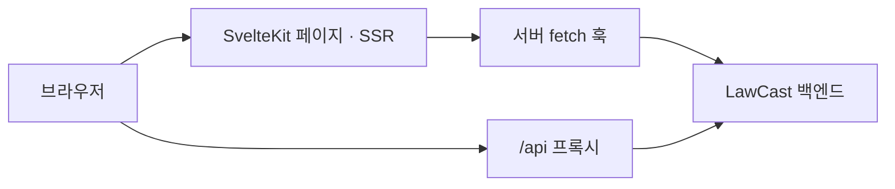

# LawCast 프론트엔드

국회 입법예고를 검색하고 원문·AI 요약·변경 이력을 읽는 SvelteKit 웹 앱입니다. 익명 토론, Discord·브라우저 알림 설정, 발의 통계와 서비스 상태 화면을 제공합니다. Svelte 5, TypeScript, Tailwind CSS v4, FontAwesome을 사용합니다.

페이지의 초기 데이터는 서버에서 불러오고 브라우저의 추가 요청은 같은 출처의 `/api`를 사용합니다. 서버 훅과 API 프록시가 백엔드로 요청을 전달합니다.



## 설치와 실행

Node.js는 [.node-version](.node-version)의 `24.22.1`을 권장합니다. 지원 범위는 [package.json](package.json)의 `engines`를 따르며 의존성은 npm으로 설치합니다.

아래 명령은 별도 안내가 없으면 `frontend/`에서 실행합니다.

```bash
cd frontend
npm ci
npm run dev
```

개발 서버는 `http://localhost:5173`입니다. 실제 데이터로 사용하려면 기본 주소 `http://localhost:3001/api`의 백엔드가 실행 중이어야 합니다.

백엔드 없이 화면을 확인할 때는 모의 데이터를 사용합니다. 주요 홈·목록·상세·변경 이력·토론·상태 화면에 적용되며 실제 수집이나 알림 전송을 대신하는 기능은 아닙니다.

```bash
DIFFCHAIN_UI_MOCK=1 npm run dev
```

## 환경 설정

`frontend/.env`에 필요한 값을 넣습니다. API 프록시와 SSR이 사용하는 주소는 비공개 환경변수 `API_BASE_URL`이며, `/api`까지 포함해야 합니다.

```env
API_BASE_URL=http://localhost:3001/api
PUBLIC_HASHGUARD_URL=https://hashguard.viento.me
PUBLIC_SEMANTIC_SEARCH_ENABLED=false
PUBLIC_CF_UNDER_ATTACK_RELOAD_ENABLED=false
```

- `API_BASE_URL`: 서버에서 접근할 백엔드 주소. 기본 `http://localhost:3001/api`입니다. 브라우저는 이 주소로 직접 요청하지 않습니다. `PUBLIC_API_BASE_URL`만 설정해서는 일반 API 프록시 주소가 바뀌지 않습니다.
- `PUBLIC_HASHGUARD_URL`: 작업증명 서버. 기본 `https://hashguard.viento.me`입니다.
- `PUBLIC_SEMANTIC_SEARCH_ENABLED`: 의미 검색 컨트롤과 전용 페이지 활성화. 미설정 시 꺼지며 `true`, `1`, `yes`, `on`으로 켭니다. 백엔드와 의미 검색 엔진 연결도 별도로 준비해야 합니다.
- `PUBLIC_CF_UNDER_ATTACK_RELOAD_ENABLED`: Cloudflare 챌린지 감지 후 자동 재로드 여부. 기본은 꺼짐입니다.
- `PUBLIC_DISCORD_SERVER_URL`, `PUBLIC_DISCORD_SERVER_ID`: 선택적인 Discord 커뮤니티 링크·위젯 설정입니다.
- `PUBLIC_GTM_CONTAINER_ID`: 선택적인 Google Tag Manager 컨테이너 ID. 빌드 시 포함되므로 변경 후 재빌드해야 하며 미설정이면 GTM 로딩과 페이지뷰 전송을 생략합니다.

그 밖의 값은 [.env.example](.env.example)을 참고하되 API 연결에는 위의 `API_BASE_URL`을 명시하세요. `PUBLIC_*` 값은 브라우저에 공개되므로 비밀키를 넣지 않습니다. Cloudflare에서는 런타임 바인딩, Node 서버에서는 시작 시 환경변수로 연결 값을 전달합니다.

## 화면과 검색

- `/`: 빠른 검색, 최근 입법예고와 서비스 개요.
- `/notices`: 입법예고 목록, 검색 방식·날짜·발의자·종료 여부 필터.
- `/notices/[num]`: 원문·AI 요약·보관 스크린샷·변경 이력·리비전 비교·내보내기.
- `/notices/changes`: 전체 변경 내역.
- `/discussions`, `/notices/[num]/discussions/[threadId]`: 익명 토론 목록과 스레드.
- `/webhook`: Discord·브라우저 알림 설정.
- `/proposals`, `/status`, `/crawling-transparency`: 발의 통계, 상태와 수집 출처.
- `/announcements`, `/announcements/[id]`: 관리자 공지.

의미 검색 플래그가 켜져 있으면 `/notices`에서 자동·키워드·의미 검색을 선택할 수 있고, `/notices/semantic-search` 전용 페이지도 열립니다. 플래그가 켜진 상태에서 검색 방식이 없는 URL은 `auto`, 꺼진 상태에서는 `keyword`로 해석합니다.

`npm run dev`에서는 전용 의미 검색과 공고 목록의 자동·의미 검색을 실행하면 오른쪽에 **Search Timing** 패널이 열립니다. 워터폴은 SvelteKit 전체(응답 본문 처리까지), 백엔드 처리(응답 헤더까지), 사이드카 호출별 왕복 및 Dense·Annotate 시간을 같은 축에 표시합니다. 점선 막대는 서버 간 시계가 독립적이어서 시작 위치를 추정한 것이며, 막대 길이는 측정 시간입니다. 구버전 백엔드가 오프셋을 반환하지 않으면 해당 구간은 상세 숫자로만 표시됩니다.

같은 탭의 최근 요청 20건을 검색 화면 간 이동과 새로고침 이후에도 보관합니다. 패널을 접거나 이전 요청을 선택하거나 기록을 지울 수 있습니다. 키워드 전용 검색은 새 기록을 만들지 않으며, 운영 빌드에서는 패널과 기록 저장이 모두 꺼집니다.

너비 조절 손잡이는 화면이 충분히 넓을 때 패널 왼쪽에 표시됩니다. 드래그하거나 손잡이에 포커스를 둔 뒤 왼쪽·오른쪽 화살표를 누르면 너비가 바뀝니다. 마지막 너비와 접기 상태는 같은 브라우저에서 새로고침해도 복원됩니다. 좁은 화면에서는 저장한 너비를 바꾸지 않고 현재 화면에 맞춥니다.

이전 기록을 선택한 뒤 **최신 요청과 비교**를 누르면 두 워터폴이 같은 밀리초 눈금으로 나란히 표시됩니다. 각 구간의 차이는 최신 시간에서 이전 시간을 뺀 값입니다. 사이드카 호출은 경로, 청크 수, 응답 상태와 같은 유형 내 발생 순서가 일치할 때만 비교하며, 한쪽에만 있는 구간은 비교값을 표시하지 않습니다.

새 사이드카에서는 Dense 아래에 **질의 임베딩**, **FAISS 조회·정렬**, **관련도 분류**의 측정 위치와 시간이 표시됩니다. 이전 기록에 세부 계측이 없으면 Dense 총시간은 비교할 수 있지만, 누락된 세부 값은 비교하지 않습니다.

키워드 검색은 제목·위원회·제안자·제안이유의 일치를 찾습니다. 자동·의미 검색은 엔진이 반환한 관련도순 후보를 보여주며 후보 수가 제한되므로 전체 키워드 검색과 건수가 다를 수 있습니다. 엔진 장애 등으로 키워드 검색이 적용되면 대체 안내를 표시합니다. 관련도가 낮은 결과는 사용자가 펼쳐서 확인합니다.

AI 요약은 참고용 정보입니다. 세부 내용은 원문과 보관 기록을 함께 확인할 수 있습니다. 검색 방식의 공통 설명과 플래그 해석은 [semantic-search.ts](src/lib/utils/semantic-search.ts), API 타입은 [api.ts](src/lib/types/api.ts)에서 관리합니다.

## 빌드와 배포

### Cloudflare Pages

기본 빌드는 Cloudflare 어댑터를 사용하며 출력은 `.svelte-kit/cloudflare`입니다.

```bash
npm run build
npm run preview
```

운영은 [.github/workflows/deploy-pages.yml](.github/workflows/deploy-pages.yml)이 담당합니다. 프론트엔드 저장소의 `main` 푸시 또는 `main`에서 시작한 수동 실행만 기존 `lawcast-frontend` Pages 프로젝트에 배포합니다. 루트 Docker Compose에는 프론트엔드 서비스가 없습니다.

- GitHub `production` 환경의 Secret: `CLOUDFLARE_API_TOKEN`.
- 저장소 Variables: `CLOUDFLARE_ACCOUNT_ID`, `PUBLIC_GTM_CONTAINER_ID`. 운영 워크플로는 GTM 값도 필수로 확인합니다.
- Pages 런타임 변수: Cloudflare에서 접근 가능한 `API_BASE_URL`과 필요한 공개 플래그. 기존 암호화된 값은 유지합니다.

Cloudflare의 Git 연결을 다시 붙여 별도 배포 경로를 만들지 않습니다. 배포 후에는 Actions 결과와 Pages에 기록된 커밋 SHA를 함께 확인합니다. 백엔드 변경이 필요한 프론트엔드는 백엔드가 먼저 배포되어야 합니다.

### Node 서버

Node로 직접 서비스할 때는 전용 빌드를 사용합니다. 기본 Cloudflare 빌드는 `build/`를 갱신하지 않습니다.

```bash
npm run build:node
npm run start:node
```

`build:node`는 `SVELTE_ADAPTER=node`로 `build/index.js`를 생성합니다. `start:node`는 `.env`를 읽어 시작하며 포트·외부 주소는 어댑터의 `PORT`, `HOST`, `ORIGIN` 설정을 사용합니다. 저장소의 Dockerfile도 Node 빌드를 사용합니다.

## 검사와 테스트

```bash
npm run lint
npm run check
npm run build
```

`lint`는 Prettier와 ESLint 자동 수정을 포함합니다. 저장소 루트에서는 `python3 tools/check-agent-guidelines.py`도 실행합니다.

브라우저 테스트는 Chromium을 설치한 뒤 실행합니다.

```bash
npx playwright install chromium
DIFFCHAIN_UI_MOCK=1 npm run test:e2e
```

기본 Playwright 설정은 개발 서버를 모의 데이터 모드로 시작합니다. 다만 일부 스펙은 테스트 프로세스의 플래그도 확인하므로 명령 앞에 `DIFFCHAIN_UI_MOCK=1`을 명시합니다. 이미 실행 중인 개발 서버를 재사용할 수 있으니 다른 설정으로 띄운 서버가 없는지 확인하세요.

실제 백엔드에 연결하는 검사는 별도 명령입니다.

```bash
npm run test:e2e:integration
```

의미 검색·요청 제한·IP 전달·챌린지·PWA·분석 동의 등은 전용 설정이 필요하며 기본 스위트 하나로 모든 스펙을 실행하지는 않습니다. 전체 스크립트는 `package.json`, 설정은 [playwright-configs/](playwright-configs/)에서 확인합니다.

```bash
npm run test:e2e:semantic-search
npm run test:e2e:pwa
npm run test:e2e:pwa:cloudflare
npx playwright test --config playwright-configs/playwright.analytics.config.ts
```

성능 검사는 `npm run test:e2e:web-vitals`와 `npm run audit:lighthouse`로 실행합니다. Lighthouse는 기본적으로 운영 공개 페이지를 측정하므로 로컬 대상을 검사하려면 `--url`을 지정하세요. 서로 비교할 때는 같은 빌드·데이터·브라우저·네트워크 조건을 사용합니다.

## PWA와 방문 통계

HTTPS 또는 localhost에서 PWA 설치와 Web Push 서비스워커(`/sw.js`)를 사용합니다. 오프라인에서는 안내와 재시도를 제공하며 최신 입법예고와 API 응답을 오프라인 검색용으로 저장하지 않습니다. 설치 안내의 노출 여부와 실제 설치 방식은 브라우저에 따라 다릅니다.

방문 통계는 분석 동의 후에만 페이지뷰를 전송하며 광고 동의는 허용하지 않습니다. GTM 컨테이너에는 `virtual_pageview`를 받는 GA4 `page_view` 이벤트를 설정하고 자동 History 페이지뷰와의 중복을 피해야 합니다. 동의 처리와 페이지뷰 계약은 [gtm.ts](src/lib/utils/gtm.ts), [consent.ts](src/lib/utils/consent.ts)와 전용 테스트에서 확인합니다.

## 코드 구조

- `src/routes/`: 페이지, 서버 로더와 API 프록시.
- `src/lib/components/`: 공통 UI.
- `src/lib/api/`, `src/lib/types/`: API 클라이언트와 타입.
- `src/lib/server/`: SSR 데이터 처리와 모의 데이터.
- `src/hooks.server.ts`: 서버 API 요청 전달.
- `static/`: 아이콘·폰트·서비스워커 등 정적 파일.
- `e2e/`, `playwright-configs/`: 브라우저 테스트와 실행 환경.

## 라이선스

MIT
